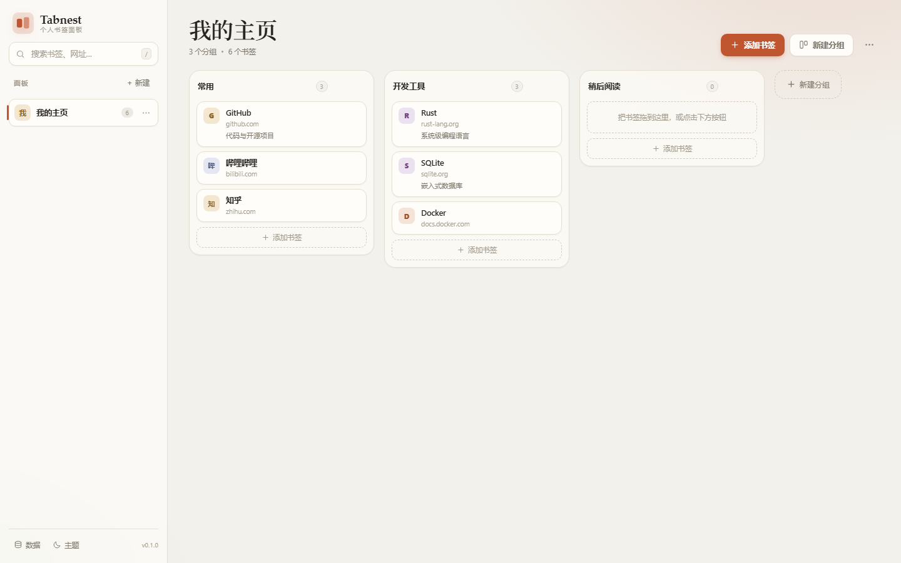
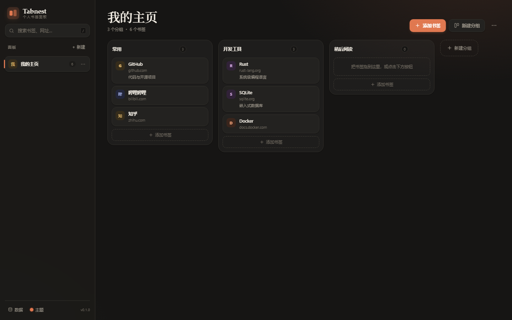
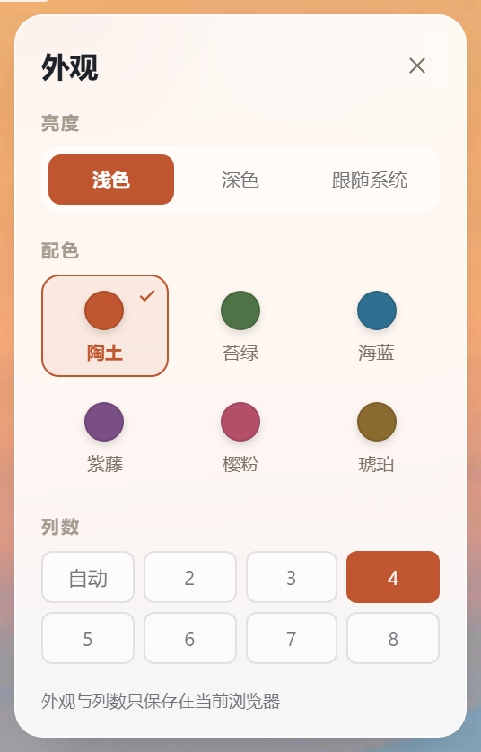

# Tabnest · 个人书签面板

Tabnest 是一个自托管的 **Papaly 风格书签起始页**：用「面板 → 分组 → 书签卡片」整理网址，支持拖拽排序、跨分组移动、全文搜索、浏览器书签导入与导出。为个人使用设计，没有分享、协作和多用户功能。

- 后端：Rust + Axum + SQLx + SQLite（WAL）
- 前端：原生 HTML / CSS / JavaScript，无构建步骤
- 部署：单二进制或 Docker Compose，数据落在宿主机 `./data` 目录
- 访问保护：单密码登录（默认强制；仅回环监听或显式 `ALLOW_INSECURE=true` 可免密）

## 界面

| 浅色 | 深色 |
| --- | --- |
|  |  |

---

## 功能

| 功能 | 说明 |
| --- | --- |
| 面板 / 分组 / 书签 | 侧栏切换面板，每个面板可建多个分组，书签卡片可拖拽调整顺序 |
| 拖拽 | 拖动卡片跨分组移动、拖动分组头横向排序、拖动侧栏面板排序 |
| 添加书签 | 粘贴网址自动抓取网页标题和 favicon；也可手填标题、备注 |
| 搜索 | 标题、网址、备注、分组名全文过滤，结果按面板分组 |
| 外观 | 6 套配色（陶土 / 苔绿 / 海蓝 / 紫藤 / 樱粉 / 琥珀）× 浅色 / 深色 / 跟随系统 |
| 导入导出 | 导入 Tabnest JSON 或 Chrome/Edge/Firefox 导出的 HTML；导出 JSON（备份）或 HTML（可再导入浏览器） |
| 图标缓存 | favicon 由服务端代理下载并缓存在 `data/favicons/`，不依赖第三方图标服务 |
| 访问保护 | 单密码登录；非回环监听且未设密码时拒绝启动；会话 7 天滑动过期 |
| 快捷键 | `/` 或 `Ctrl/⌘ + K` 聚焦搜索，`n` 新建书签，`Esc` 关闭 / 清空搜索 |

左下角「主题」可以切换 6 套配色和明暗模式，设置只保存在当前浏览器。



## 快速开始（Docker Compose）

```bash
cd /opt/code
cp .env.example .env
# 打开 .env，至少填写一个访问密码：
#   APP_PASSWORD=你的密码
# 确实要在内网无鉴权运行时，才设置 ALLOW_INSECURE=true
docker compose up -d --build
```

打开 `http://<服务器地址>:8420`（当前这台机器上是 `http://192.168.20.110:8420`）。

默认配置：

- 端口：宿主机 `8420` → 容器 `8080`
- 数据：`./data/tabnest.db`（SQLite）、`./data/favicons/`
- 首次启动写入一块示例面板（`SEED_DEMO=false` 可关闭）
- **未设置密码且监听非回环地址时，程序会拒绝启动**；如需无鉴权运行必须显式设置 `ALLOW_INSECURE=true`

停止 / 更新：

```bash
docker compose down
docker compose up -d --build
```

### 环境变量

| 变量 | 默认值 | 说明 |
| --- | --- | --- |
| `PORT` | `8420` | Compose 映射到宿主机的端口 |
| `APP_PASSWORD` | 空 | 非空时启用单密码登录；为空且监听非回环地址时拒绝启动 |
| `ALLOW_INSECURE` | `false` | 明确允许无密码运行（危险） |
| `ALLOW_PRIVATE_NETWORK` | `false` | 允许服务端抓取内网 / 本机地址（SSRF 风险，默认关闭） |
| `COOKIE_SECURE` | `false` | 会话 Cookie 加 `Secure` 并使用 `__Host-` 前缀；HTTPS 反向代理后开启 |
| `TRUST_PROXY` | `false` | 旧兼容开关：信任任意对端的转发头；建议改用 `TRUSTED_PROXIES` |
| `TRUSTED_PROXIES` | 空 | 可信代理 CIDR 列表（逗号分隔），如 `172.16.0.0/12`；仅这些网段可提供 `CF-Connecting-IP` / XFF |
| `SEED_DEMO` | `true` | 空数据库首次启动时写入示例内容 |
| `BIND_ADDR` | `0.0.0.0:8080` | 容器内监听地址 |
| `DATA_DIR` | `/data` | 数据库与图标缓存目录 |
| `DB_PATH` | `$DATA_DIR/tabnest.db` | 单独指定数据库路径 |
| `RUST_LOG` | `tabnest=info,sqlx=warn` | 日志级别 |
| `CARGO_REGISTRY_MIRROR` | 空 | 构建时使用的 crates.io 镜像，如 `https://rsproxy.cn/index/`（仅 Docker 构建） |
| `DEBIAN_MIRROR` | 空 | 构建时替换的 Debian 镜像域名，如 `mirrors.aliyun.com`（仅 Docker 构建） |
| `TZ` | `Asia/Shanghai` | 时区 |

> 如果直接运行二进制，需要在 `.env` 中确认 `DATA_DIR` 与 `DB_PATH` 指向可写目录。
> 修改 `APP_PASSWORD` / `PORT` 后执行 `docker compose up -d` 让容器重建生效。

## 不用 Docker

```bash
cargo build --release
DATA_DIR=./data BIND_ADDR=127.0.0.1:8420 ./target/release/tabnest
```

需要 Rust 1.85+（已在 1.92 上验证），Linux 下需要 OpenSSL 开发包（`libssl-dev` / `openssl-devel`）。

运行测试：

```bash
cargo test
```

## 数据与备份

所有内容都在一个 SQLite 文件里（`data/tabnest.db`）。三种备份方式：

1. 侧栏底部「数据 → 导出 JSON」，适合迁移和增量备份；
2. `docker compose stop && cp data/tabnest.db backup/`；
3. 使用 `sqlite3 data/tabnest.db ".backup 'backup.db'"`（WAL 模式下推荐）。

恢复：停止容器，用备份文件替换 `data/tabnest.db`，再启动。

## 导入浏览器书签

在 Chrome / Edge 中打开 `chrome://bookmarks` → 右上角菜单 → 导出书签，得到 HTML 文件；在 Tabnest 里点侧栏底部「数据 → 导入 → 选择文件」，或直接把文件拖进对话框。

映射规则：

- 一级文件夹 → 面板
- 二级及更深文件夹 → 分组（更深层级用 ` / ` 连接）
- 文件夹里的直接书签 → 该文件夹对应面板的「全部」分组
- 重复网址（已存在数据库中的）自动跳过

## 开发

```bash
cargo check
cargo test
cargo run
```

前端没有打包工具：修改 `static/index.html`、`static/style.css`、`static/app.js` 后重启二进制即可（资源通过 `include_str!` 编译进程序，改完需要重新编译）。

### 目录结构

```
src/main.rs        启动、日志、优雅退出
src/api.rs         JSON API、排序、导入导出接口
src/db.rs          SQLite 连接、建表、示例数据、批量导入
src/fetch.rs       网址规范化、网页标题 / favicon 抓取、HTML 实体解码
src/import.rs      Netscape 书签 HTML 解析
src/auth.rs        可选密码、Cookie 会话
src/assets.rs      内嵌前端资源与健康检查
static/            原生前端
migrations/        SQLite schema
```

### API 摘要（均需登录，若启用密码）

| 方法 | 路径 | 说明 |
| --- | --- | --- |
| GET | `/api/state` | 一次返回全部面板 / 分组 / 书签 |
| POST | `/api/boards` | 新建面板 `{name}` |
| PATCH/DELETE | `/api/boards/{id}` | 重命名 / 删除面板 |
| PUT | `/api/boards/order` | 面板排序 `{ids}` |
| POST | `/api/columns` | 新建分组 `{board_id, name}` |
| PATCH/DELETE | `/api/columns/{id}` | 重命名 / 删除分组 |
| PUT | `/api/columns/order` | 分组排序 `{board_id, ids}` |
| POST | `/api/links` | 新建书签 `{column_id, url, title?, note?, icon?}` |
| PATCH/DELETE | `/api/links/{id}` | 编辑 / 删除书签 |
| PUT | `/api/links/arrange` | 跨分组 / 组内排序 `{columns:[{column_id, link_ids}]}` |
| GET | `/api/meta?url=` | 抓取标题与图标 |
| GET | `/api/favicon?u=` | favicon 代理（磁盘缓存） |
| POST | `/api/import/json`、`/api/import/html` | 导入（原始文本 body） |
| GET | `/api/export/json`、`/api/export/html` | 导出下载 |
| POST | `/api/login`、`/api/logout` | 登录 / 退出 |

## 安全说明

- **默认拒绝无密码暴露**：`APP_PASSWORD` 为空且 `BIND_ADDR` 不是回环地址时，程序启动即报错。只有显式设置 `ALLOW_INSECURE=true` 才会继续。
- **SSRF 防护**：`/api/meta`、`/api/favicon`、新建书签的自动抓取都会解析域名并检查 IP，默认拒绝回环、私网、链路本地、CGNAT、组播等地址；重定向逐跳校验，DNS 结果固定到已校验的 IP，避免 DNS rebinding。确需收藏内网地址时设置 `ALLOW_PRIVATE_NETWORK=true`。
- **favicon 只接受位图**：PNG / JPEG / GIF / WebP / ICO；SVG 被拒绝，响应带 `nosniff`、`Content-Security-Policy: default-src 'none'; sandbox`，避免同源 SVG XSS。
- **登录限速**：同一 IP 10 分钟内失败 5 次后锁定 30 秒，继续失败按 60 秒 / 2 分钟 / … / 15 分钟递增；返回 429 + `Retry-After`。位于 Cloudflare / 反向代理后时，通过可信代理网段读取 `CF-Connecting-IP`（XFF 只取最右侧非代理跳），避免所有访客共用一个边缘 IP 的额度。密码比较先做 SHA-256 再恒定时间比较，不泄露长度。
- **会话**：7 天滑动过期，Cookie 为 `HttpOnly; SameSite=Lax`；启用 `COOKIE_SECURE=true` 后使用 `__Host-tabnest_session`（强制 Secure、Path=/、无 Domain）。
- **CSRF**：所有写接口校验 `Origin` 与 `Sec-Fetch-Site`；跨站或同站不同端口（例如 `:3000` → `:8420`）的写请求返回 403。
- **安全响应头**：全局 CSP（脚本与样式均仅允许同源，主题引导已拆到 `/theme-init.js`）、`X-Frame-Options: DENY`、`Referrer-Policy: no-referrer`、`Permissions-Policy` 等；HTTPS 请求额外发送 HSTS。
- **缓存语义**：`/api/*` JSON 响应统一 `Cache-Control: no-store`（favicon 除外）；favicon 使用 `private` + `Vary: Cookie`。favicon 磁盘缓存最多保留 1000 个文件，超出后按修改时间淘汰。
- **部署建议**：公网或不可信网络请用 Caddy / Nginx 或 Cloudflare Tunnel 终止 TLS 并转发到 `8420`，设置 `COOKIE_SECURE=true`，并用 `TRUSTED_PROXIES` 限定可信代理网段（例如 Cloudflare Tunnel 所在 Docker 网络），不要直接打开旧的 `TRUST_PROXY`；`APP_PASSWORD` 修改后需重启容器，旧会话会失效（会话只在内存中）。源站端口应只允许 Cloudflare / 反向代理访问，避免绕过 WAF 直接打 IP。
- 容器以非 root 用户 `tabnest`（UID 10001）运行；入口脚本只用 root 修正 `./data` 权限，随后立即降权。
- 依赖库（tokio / sqlx / openssl 等）内部仍会使用 `unsafe` 与 C 库交互；应用代码通过 `#![forbid(unsafe_code)]` 禁止手写 `unsafe`。

## License

MIT
